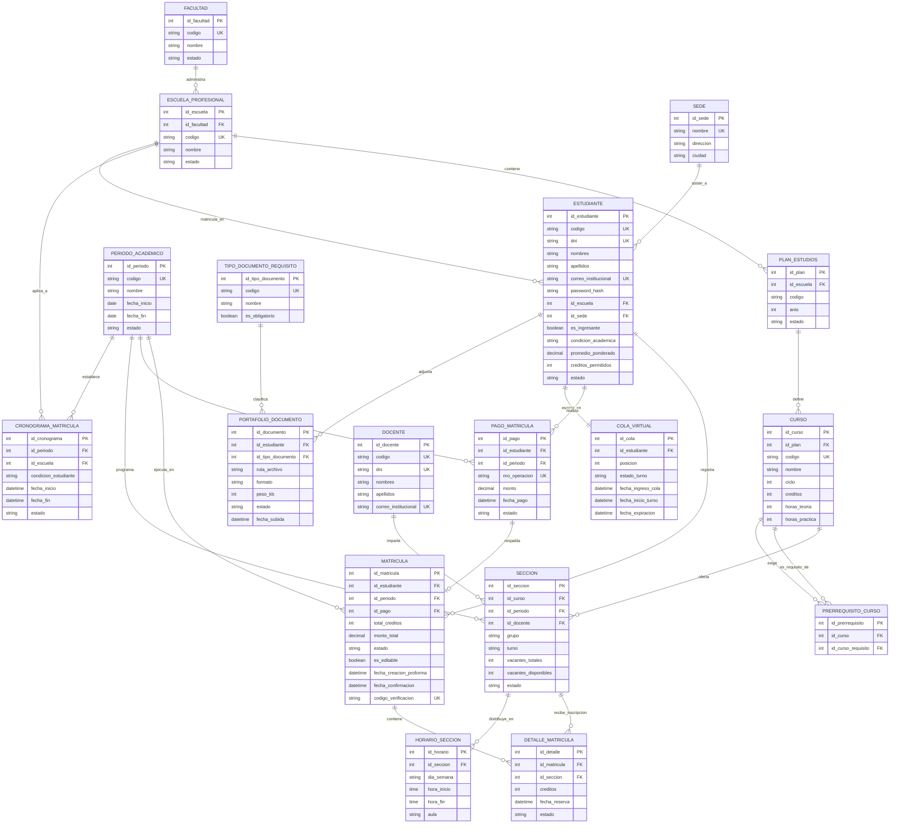

# DOCUMENTACIÓN TÉCNICA DE BASE DE DATOS (MySQL)
## SISTEMA WEB DE MATRÍCULA UNIVERSITARIA - UNJBG

**Documento Fuente:** [REQUERIMIENTOS.md](REQUERIMIENTOS.md)  
**Motor de Base de Datos:** MySQL 8.0+ (Motor de Almacenamiento: `InnoDB` para soporte ACID y bloqueos a nivel de fila)  
**Normalización:** Tercera Forma Normal (3FN) garantizada  
**Mecanismos Especiales:** Bloqueo Pesimista (`SELECT ... FOR UPDATE`), Transacciones ACID (`START TRANSACTION`, `COMMIT`, `ROLLBACK`), Restricciones de Integridad Referencial (`FOREIGN KEY ON DELETE RESTRICT`).

---

## 1. PLANTEAMIENTO DE ENTIDADES

El modelo relacional ha sido diseñado para soportar de forma robusta la alta concurrencia y las reglas de negocio del proceso de matrícula universitaria. Se identifican 6 áreas funcionales estructuradas en 15 entidades normalizadas en 3FN:

### 1.1. Estructura Académica e Institucional
* **`facultad`:** Representa las unidades académicas mayores de la universidad (ej. Facultad de Ingeniería).
* **`escuela_profesional`:** Especialidades o carreras adscritas a cada facultad (ej. Ingeniería en Informática y Sistemas).
* **`sede`:** Campus físico o filial donde se imparten las clases (ej. Sede Central Capanique, Sede Tarata).
* **`periodo_academico`:** Ciclos semestrales lectivos (ej. "2026-II") con fechas límite de planificación y ejecución.

### 1.2. Estudiantes y Control de Acceso
* **`estudiante`:** Contiene los datos biográficos, credenciales de acceso, condición académica (Especial, Regular, Destacado) y promedio acumulado que determina la bolsa de créditos.
* **`cronograma_matricula`:** Regula la ventana de tiempo (fecha/hora inicio y fin) en la que un estudiante puede ingresar al sistema según su escuela y condición (ingresante o regular), evitando accesos fuera de fecha.

### 1.3. Portafolio de Requisitos de Admisión
* **`tipo_documento_requisito`:** Catálogo de documentos exigidos por admisión (Constancia de Ingreso, DNI, Foto de Carné y Certificado de Salud).
* **`portafolio_documento`:** Almacena los metadatos de las imágenes adjuntas por los ingresantes (ruta, peso, formato JPG/PNG) y su estado de validación.

### 1.4. Cola Virtual y Concurrencia
* **`cola_virtual`:** Gestiona la sala de espera en memoria de BD, registrando el número de turno, la posición en fila, la activación del turno y la hora exacta de expiración del temporizador de 5 minutos (300 segundos).

### 1.5. Plan de Estudios, Oferta de Asignaturas y Horarios
* **`plan_estudios`:** Versión curricular de cada carrera profesional.
* **`curso`:** Materias académicas del plan de estudios, definiendo su ciclo, créditos y horas pedagógicas.
* **`prerrequisito_curso`:** Modela la relación recursiva de prelación de asignaturas (un curso exige haber aprobado uno o más cursos previos).
* **`docente`:** Profesores registrados para el dictado lectivo.
* **`seccion`:** Oferta de cursos dividida en turnos: **Grupo A (Mañana)** y **Grupo B (Tarde)**. Aloja el campo crítico `vacantes_disponibles` sobre el cual opera el bloqueo pesimista `SELECT ... FOR UPDATE`.
* **`horario_seccion`:** Distribución de bloques de clase (día de la semana, hora inicio, hora fin y aula), utilizado para calcular cruces de horario.

### 1.6. Proforma, Pagos y Confirmación de Matrícula
* **`pago_matricula`:** Registra el comprobante y validación del pago por derecho de matrícula necesario para confirmar.
* **`matricula`:** Representa la cabecera del proceso. Administra el ciclo de vida de la transacción: nace en estado `PROFORMA` y, tras cumplir todas las validaciones de créditos y pagos, transiciona a `CONFIRMADA`, activando el flag de inmutabilidad (`es_editable = FALSE`).
* **`detalle_matricula`:** Registra las secciones agregadas por el alumno, asociando los créditos y el estado de la reserva de cupo (temporal o consolidada).

---

## 2. DICCIONARIO DE DATOS (DETALLE DE TABLAS Y ATRIBUTOS)

### 2.1. Tabla: `facultad`
| Nombre del Atributo | Tipo de Dato | Claves | Nulabilidad | Descripción y Propósito |
| :--- | :--- | :---: | :---: | :--- |
| `id_facultad` | INT AUTO_INCREMENT | **PK** | NOT NULL | Identificador primario de la facultad. |
| `codigo` | VARCHAR(10) | **UK** | NOT NULL | Código único de la facultad (ej. "FAING"). |
| `nombre` | VARCHAR(120) | - | NOT NULL | Nombre oficial de la facultad. |
| `estado` | ENUM('ACTIVO','INACTIVO') | - | NOT NULL | Estado operativo de la unidad académica. Default 'ACTIVO'. |

---

### 2.2. Tabla: `escuela_profesional`
| Nombre del Atributo | Tipo de Dato | Claves | Nulabilidad | Descripción y Propósito |
| :--- | :--- | :---: | :---: | :--- |
| `id_escuela` | INT AUTO_INCREMENT | **PK** | NOT NULL | Identificador primario de la escuela profesional. |
| `id_facultad` | INT | **FK** | NOT NULL | Referencia a la facultad a la que pertenece (`facultad.id_facultad`). |
| `codigo` | VARCHAR(10) | **UK** | NOT NULL | Código institucional de la carrera (ej. "ESIS"). |
| `nombre` | VARCHAR(120) | - | NOT NULL | Nombre de la escuela (ej. "Ingeniería en Informática y Sistemas"). |
| `estado` | ENUM('ACTIVO','INACTIVO') | - | NOT NULL | Estado de la carrera. Default 'ACTIVO'. |

---

### 2.3. Tabla: `sede`
| Nombre del Atributo | Tipo de Dato | Claves | Nulabilidad | Descripción y Propósito |
| :--- | :--- | :---: | :---: | :--- |
| `id_sede` | INT AUTO_INCREMENT | **PK** | NOT NULL | Identificador primario de la sede. |
| `nombre` | VARCHAR(100) | **UK** | NOT NULL | Nombre del campus o filial (ej. "Sede Central Capanique"). |
| `direccion` | VARCHAR(200) | - | NOT NULL | Dirección física de la sede. |
| `ciudad` | VARCHAR(50) | - | NOT NULL | Ciudad donde se ubica la sede (ej. "Tacna"). |

---

### 2.4. Tabla: `periodo_academico`
| Nombre del Atributo | Tipo de Dato | Claves | Nulabilidad | Descripción y Propósito |
| :--- | :--- | :---: | :---: | :--- |
| `id_periodo` | INT AUTO_INCREMENT | **PK** | NOT NULL | Identificador primario del periodo lectivo. |
| `codigo` | VARCHAR(10) | **UK** | NOT NULL | Código representativo del ciclo (ej. "2026-II"). |
| `nombre` | VARCHAR(50) | - | NOT NULL | Nombre descriptivo (ej. "Semestre Académico 2026-II"). |
| `fecha_inicio` | DATE | - | NOT NULL | Fecha de inicio formal del periodo académico. |
| `fecha_fin` | DATE | - | NOT NULL | Fecha de culminación del periodo académico. |
| `estado` | ENUM('PLANIFICACION','ACTIVO','CERRADO') | - | NOT NULL | Estado del periodo. Solo periodos 'ACTIVO' admiten matrícula. |

---

### 2.5. Tabla: `estudiante`
| Nombre del Atributo | Tipo de Dato | Claves | Nulabilidad | Descripción y Propósito |
| :--- | :--- | :---: | :---: | :--- |
| `id_estudiante` | INT AUTO_INCREMENT | **PK** | NOT NULL | Identificador único del estudiante. |
| `codigo` | VARCHAR(10) | **UK** | NOT NULL | Código universitario del alumno (ej. "2024-119001"). |
| `dni` | CHAR(8) | **UK** | NOT NULL | Número de Documento Nacional de Identidad. |
| `nombres` | VARCHAR(100) | - | NOT NULL | Nombres completos del estudiante. |
| `apellidos` | VARCHAR(100) | - | NOT NULL | Apellidos paterno y materno del estudiante. |
| `correo_institucional` | VARCHAR(150) | **UK** | NOT NULL | Correo electrónico con dominio @unjbg.edu.pe. |
| `password_hash` | VARCHAR(255) | - | NOT NULL | Contraseña encriptada (Bcrypt / Argon2). |
| `id_escuela` | INT | **FK** | NOT NULL | Escuela profesional en la que está inscrito (`escuela_profesional.id_escuela`). |
| `id_sede` | INT | **FK** | NOT NULL | Sede académica de residencia del alumno (`sede.id_sede`). |
| `es_ingresante` | BOOLEAN | - | NOT NULL | Indica si es alumno ingresante (TRUE) o regular (FALSE). Default FALSE. |
| `condicion_academica` | ENUM('ESPECIAL','REGULAR','DESTACADO') | - | NOT NULL | Condición del alumno para cálculo de créditos. Default 'REGULAR'. |
| `promedio_ponderado` | DECIMAL(4,2) | - | NOT NULL | Promedio ponderado acumulado del estudiante (ej. 15.40). Default 0.00. |
| `creditos_permitidos` | INT | - | NOT NULL | Tope máximo de créditos asignados según condición (11, 23 o 28). |
| `estado` | ENUM('ACTIVO','INACTIVO','EGRESADO') | - | NOT NULL | Estado administrativo del estudiante. |
| `created_at` | TIMESTAMP | - | NOT NULL | Fecha y hora de creación del registro. Default CURRENT_TIMESTAMP. |

---

### 2.6. Tabla: `cronograma_matricula`
| Nombre del Atributo | Tipo de Dato | Claves | Nulabilidad | Descripción y Propósito |
| :--- | :--- | :---: | :---: | :--- |
| `id_cronograma` | INT AUTO_INCREMENT | **PK** | NOT NULL | Identificador del bloque de cronograma. |
| `id_periodo` | INT | **FK** | NOT NULL | Periodo académico correspondiente (`periodo_academico.id_periodo`). |
| `id_escuela` | INT | **FK** | NOT NULL | Escuela profesional asignada (`escuela_profesional.id_escuela`). |
| `condicion_estudiante` | ENUM('INGRESANTE','REGULAR','TODOS') | - | NOT NULL | Segmentación del grupo de alumnos habilitado. |
| `fecha_inicio` | DATETIME | - | NOT NULL | Fecha y hora exacta de inicio de acceso a la plataforma. |
| `fecha_fin` | DATETIME | - | NOT NULL | Fecha y hora exacta de cierre de acceso para el grupo. |
| `estado` | ENUM('ACTIVO','INACTIVO') | - | NOT NULL | Habilitación manual del cronograma. |

---

### 2.7. Tabla: `tipo_documento_requisito`
| Nombre del Atributo | Tipo de Dato | Claves | Nulabilidad | Descripción y Propósito |
| :--- | :--- | :---: | :---: | :--- |
| `id_tipo_documento` | INT AUTO_INCREMENT | **PK** | NOT NULL | Identificador del tipo de documento de admisión. |
| `codigo` | VARCHAR(30) | **UK** | NOT NULL | Clave textual (ej. 'CONSTANCIA_INGRESO', 'DNI', 'FOTO_CARNE', 'EXAMEN_SALUD'). |
| `nombre` | VARCHAR(100) | - | NOT NULL | Nombre descriptivo del documento requerido. |
| `es_obligatorio` | BOOLEAN | - | NOT NULL | Define si es requisito indispensable para acceder a matrícula. Default TRUE. |

---

### 2.8. Tabla: `portafolio_documento`
| Nombre del Atributo | Tipo de Dato | Claves | Nulabilidad | Descripción y Propósito |
| :--- | :--- | :---: | :---: | :--- |
| `id_documento` | INT AUTO_INCREMENT | **PK** | NOT NULL | Identificador del archivo registrado. |
| `id_estudiante` | INT | **FK** | NOT NULL | Estudiante que subió el documento (`estudiante.id_estudiante`). |
| `id_tipo_documento` | INT | **FK** | NOT NULL | Tipo de documento adjuntado (`tipo_documento_requisito.id_tipo_documento`). |
| `ruta_archivo` | VARCHAR(255) | - | NOT NULL | Ruta de almacenamiento en el servidor o bucket (ej. /uploads/portafolio/...). |
| `formato` | VARCHAR(10) | - | NOT NULL | Extensión del archivo validada (JPG o PNG). |
| `peso_kb` | INT | - | NOT NULL | Tamaño del archivo en kilobytes (máx. 2048 KB). |
| `estado` | ENUM('PENDIENTE','ENTREGADO','OBSERVADO','VALIDADO') | - | NOT NULL | Estado de revisión del documento. Default 'ENTREGADO'. |
| `fecha_subida` | DATETIME | - | NOT NULL | Fecha y hora del guardado. Default CURRENT_TIMESTAMP. |

---

### 2.9. Tabla: `cola_virtual`
| Nombre del Atributo | Tipo de Dato | Claves | Nulabilidad | Descripción y Propósito |
| :--- | :--- | :---: | :---: | :--- |
| `id_cola` | INT AUTO_INCREMENT | **PK** | NOT NULL | Identificador de la sesión en sala de espera. |
| `id_estudiante` | INT | **FK, UK** | NOT NULL | Estudiante en la fila virtual (`estudiante.id_estudiante`). |
| `posicion` | INT | - | NOT NULL | Número correlativo de orden de llegada en la cola. |
| `estado_turno` | ENUM('EN_ESPERA','TURNO_HABILITADO','EN_MATRICULA','EXPIRADO','FINALIZADO') | - | NOT NULL | Estado del alumno en la cola. Default 'EN_ESPERA'. |
| `fecha_ingreso_cola` | DATETIME | - | NOT NULL | Momento en el que el alumno ingresa a la sala de espera. |
| `fecha_inicio_turno` | DATETIME | - | NULL | Momento en el que la posición pasa a #1 y se habilita el acceso. |
| `fecha_expiracion` | DATETIME | - | NULL | Fecha/hora máxima permitida (fecha_inicio_turno + 300 segundos). |

---

### 2.10. Tabla: `plan_estudios`
| Nombre del Atributo | Tipo de Dato | Claves | Nulabilidad | Descripción y Propósito |
| :--- | :--- | :---: | :---: | :--- |
| `id_plan` | INT AUTO_INCREMENT | **PK** | NOT NULL | Identificador del plan curricular. |
| `id_escuela` | INT | **FK** | NOT NULL | Escuela profesional dueña del plan (`escuela_profesional.id_escuela`). |
| `codigo` | VARCHAR(10) | - | NOT NULL | Código del plan (ej. "PLAN-2020"). |
| `anio` | INT | - | NOT NULL | Año de puesta en vigencia del plan de estudios. |
| `estado` | ENUM('VIGENTE','OBSOLETO') | - | NOT NULL | Indica si el plan curricular se encuentra activo. Default 'VIGENTE'. |

---

### 2.11. Tabla: `curso`
| Nombre del Atributo | Tipo de Dato | Claves | Nulabilidad | Descripción y Propósito |
| :--- | :--- | :---: | :---: | :--- |
| `id_curso` | INT AUTO_INCREMENT | **PK** | NOT NULL | Identificador primario de la asignatura. |
| `id_plan` | INT | **FK** | NOT NULL | Plan de estudios al que pertenece (`plan_estudios.id_plan`). |
| `codigo` | VARCHAR(15) | **UK** | NOT NULL | Código oficial de la materia (ej. "IS-401"). |
| `nombre` | VARCHAR(120) | - | NOT NULL | Nombre de la asignatura (ej. "Base de Datos II"). |
| `ciclo` | INT | - | NOT NULL | Ciclo lectivo sugerido en la malla (1 al 10). |
| `creditos` | INT | - | NOT NULL | Valor académico en créditos de la asignatura (ej. 3, 4 o 5). |
| `horas_teoria` | INT | - | NOT NULL | Horas semanales teóricas. |
| `horas_practica` | INT | - | NOT NULL | Horas semanales de práctica o laboratorio. |

---

### 2.12. Tabla: `prerrequisito_curso`
| Nombre del Atributo | Tipo de Dato | Claves | Nulabilidad | Descripción y Propósito |
| :--- | :--- | :---: | :---: | :--- |
| `id_prerrequisito` | INT AUTO_INCREMENT | **PK** | NOT NULL | Identificador de la regla de prelación. |
| `id_curso` | INT | **FK** | NOT NULL | Asignatura destino que exige el requisito (`curso.id_curso`). |
| `id_curso_requisito` | INT | **FK** | NOT NULL | Asignatura previa que debe estar aprobada (`curso.id_curso`). |

---

### 2.13. Tabla: `docente`
| Nombre del Atributo | Tipo de Dato | Claves | Nulabilidad | Descripción y Propósito |
| :--- | :--- | :---: | :---: | :--- |
| `id_docente` | INT AUTO_INCREMENT | **PK** | NOT NULL | Identificador único del docente. |
| `codigo` | VARCHAR(15) | **UK** | NOT NULL | Código de personal docente (ej. "DOC-1045"). |
| `dni` | CHAR(8) | **UK** | NOT NULL | Documento Nacional de Identidad del docente. |
| `nombres` | VARCHAR(100) | - | NOT NULL | Nombres del profesor. |
| `apellidos` | VARCHAR(100) | - | NOT NULL | Apellidos del profesor. |
| `correo_institucional` | VARCHAR(150) | **UK** | NOT NULL | Correo de contacto institucional. |

---

### 2.14. Tabla: `seccion`
| Nombre del Atributo | Tipo de Dato | Claves | Nulabilidad | Descripción y Propósito |
| :--- | :--- | :---: | :---: | :--- |
| `id_seccion` | INT AUTO_INCREMENT | **PK** | NOT NULL | Identificador primario de la sección abierta. |
| `id_curso` | INT | **FK** | NOT NULL | Asignatura que se dicta (`curso.id_curso`). |
| `id_periodo` | INT | **FK** | NOT NULL | Periodo académico de dictado (`periodo_academico.id_periodo`). |
| `id_docente` | INT | **FK** | NOT NULL | Docente titular asignado (`docente.id_docente`). |
| `grupo` | ENUM('A','B') | - | NOT NULL | Identificador de grupo: **A (Mañana)** o **B (Tarde)**. |
| `turno` | ENUM('MANANA','TARDE') | - | NOT NULL | Franja horaria principal de la sección. |
| `vacantes_totales` | INT | - | NOT NULL | Capacidad física máxima instalada para la sección (ej. 40). |
| `vacantes_disponibles` | INT | - | NOT NULL | **Campo con Bloqueo Pesimista (`FOR UPDATE`).** Cupos libres en tiempo real. |
| `estado` | ENUM('ABIERTA','CERRADA') | - | NOT NULL | Estado de la sección. Pasa a 'CERRADA' si vacantes_disponibles = 0. |

---

### 2.15. Tabla: `horario_seccion`
| Nombre del Atributo | Tipo de Dato | Claves | Nulabilidad | Descripción y Propósito |
| :--- | :--- | :---: | :---: | :--- |
| `id_horario` | INT AUTO_INCREMENT | **PK** | NOT NULL | Identificador del bloque horario. |
| `id_seccion` | INT | **FK** | NOT NULL | Sección a la que pertenece el bloque (`seccion.id_seccion`). |
| `dia_semana` | ENUM('LUNES','MARTES','MIERCOLES','JUEVES','VIERNES','SABADO') | - | NOT NULL | Día en el que se dicta la clase. |
| `hora_inicio` | TIME | - | NOT NULL | Hora de inicio de la sesión pedagógica (ej. 08:00:00). |
| `hora_fin` | TIME | - | NOT NULL | Hora de finalización de la sesión pedagógica (ej. 10:00:00). |
| `aula` | VARCHAR(30) | - | NOT NULL | Denominación del ambiente o laboratorio (ej. "Lab-Sistemas 2"). |

---

### 2.16. Tabla: `pago_matricula`
| Nombre del Atributo | Tipo de Dato | Claves | Nulabilidad | Descripción y Propósito |
| :--- | :--- | :---: | :---: | :--- |
| `id_pago` | INT AUTO_INCREMENT | **PK** | NOT NULL | Identificador primario del recibo de pago. |
| `id_estudiante` | INT | **FK** | NOT NULL | Estudiante que realiza el pago (`estudiante.id_estudiante`). |
| `id_periodo` | INT | **FK** | NOT NULL | Periodo al que aplica el pago (`periodo_academico.id_periodo`). |
| `nro_operacion` | VARCHAR(50) | **UK** | NOT NULL | Número de comprobante o voucher bancario (Banco de la Nación). |
| `monto` | DECIMAL(8,2) | - | NOT NULL | Importe cancelado en soles (S/.). |
| `fecha_pago` | DATETIME | - | NOT NULL | Fecha y hora de transacción registrada en la pasarela o banco. |
| `estado` | ENUM('PENDIENTE','PAGADO','EXONERADO','RECHAZADO') | - | NOT NULL | Estado de validación. Default 'PENDIENTE'. |

---

### 2.17. Tabla: `matricula`
| Nombre del Atributo | Tipo de Dato | Claves | Nulabilidad | Descripción y Propósito |
| :--- | :--- | :---: | :---: | :--- |
| `id_matricula` | INT AUTO_INCREMENT | **PK** | NOT NULL | Identificador único de la matrícula. |
| `id_estudiante` | INT | **FK** | NOT NULL | Estudiante matriculado (`estudiante.id_estudiante`). |
| `id_periodo` | INT | **FK** | NOT NULL | Periodo lectivo vigente (`periodo_academico.id_periodo`). |
| `id_pago` | INT | **FK** | NULL | Recibo de pago validado (`pago_matricula.id_pago`). |
| `total_creditos` | INT | - | NOT NULL | Sumatoria de créditos de las materias inscritas. Default 0. |
| `monto_total` | DECIMAL(8,2) | - | NOT NULL | Monto liquidado por la matrícula. Default 0.00. |
| `estado` | ENUM('PROFORMA','CONFIRMADA','CANCELADA','ANULADA') | - | NOT NULL | **Estado Transaccional.** Nace en 'PROFORMA' y culmina en 'CONFIRMADA'. |
| `es_editable` | BOOLEAN | - | NOT NULL | Bandera de inmutabilidad. Pasa a FALSE al confirmarse. Default TRUE. |
| `fecha_creacion_proforma` | DATETIME | - | NOT NULL | Momento de apertura de la proforma temporal. Default CURRENT_TIMESTAMP. |
| `fecha_confirmacion` | DATETIME | - | NULL | Momento exacto en el que el alumno presiona "Confirmar Matrícula". |
| `codigo_verificacion` | VARCHAR(64) | **UK** | NULL | Hash SHA-256 generado para validación QR de la Ficha en PDF. |

---

### 2.18. Tabla: `detalle_matricula`
| Nombre del Atributo | Tipo de Dato | Claves | Nulabilidad | Descripción y Propósito |
| :--- | :--- | :---: | :---: | :--- |
| `id_detalle` | INT AUTO_INCREMENT | **PK** | NOT NULL | Identificador del registro detalle. |
| `id_matricula` | INT | **FK** | NOT NULL | Cabecera de matrícula (`matricula.id_matricula`). |
| `id_seccion` | INT | **FK** | NOT NULL | Sección y horario reservado (`seccion.id_seccion`). |
| `creditos` | INT | - | NOT NULL | Copia histórica de los créditos de la asignatura matriculada. |
| `fecha_reserva` | DATETIME | - | NOT NULL | Momento en el que se efectuó el bloqueo pesimista. |
| `estado` | ENUM('RESERVADO_TEMPORAL','CONFIRMADO','LIBERADO') | - | NOT NULL | Estado del cupo. Default 'RESERVADO_TEMPORAL'. |

---

## 3. DEFINICIÓN DE RELACIONES ENTRE TABLAS

| Tabla Origen | Cardinalidad | Tabla Destino | Llave Foránea (FK) | Regla / Descripción de la Relación |
| :--- | :---: | :--- | :--- | :--- |
| `facultad` | 1 : N | `escuela_profesional` | `escuela_profesional.id_facultad` | Una facultad agrupa una o más escuelas profesionales (`ON DELETE RESTRICT`). |
| `escuela_profesional` | 1 : N | `estudiante` | `estudiante.id_escuela` | Cada estudiante está adscrito a una única escuela profesional. |
| `sede` | 1 : N | `estudiante` | `estudiante.id_sede` | Un estudiante está asignado a una sede física de estudios. |
| `periodo_academico` | 1 : N | `cronograma_matricula` | `cronograma_matricula.id_periodo` | Un periodo lectivo contiene múltiples bloques de cronograma. |
| `escuela_profesional` | 1 : N | `cronograma_matricula` | `cronograma_matricula.id_escuela` | El cronograma segmenta fechas de acceso por escuela profesional. |
| `estudiante` | 1 : N | `portafolio_documento` | `portafolio_documento.id_estudiante` | Un estudiante ingresante registra hasta 4 documentos en su portafolio. |
| `tipo_documento_requisito` | 1 : N | `portafolio_documento` | `portafolio_documento.id_tipo_documento` | Cada documento cargado responde a un tipo de requisito oficial de admisión. |
| `estudiante` | 1 : 1 | `cola_virtual` | `cola_virtual.id_estudiante` | Un estudiante solo puede tener un registro activo en la sala de espera concurrente (`UNIQUE`). |
| `escuela_profesional` | 1 : N | `plan_estudios` | `plan_estudios.id_escuela` | Una carrera posee uno o varios planes curriculares a lo largo de los años. |
| `plan_estudios` | 1 : N | `curso` | `curso.id_plan` | Un plan curricular contiene el catálogo completo de cursos estructurados por ciclos. |
| `curso` | 1 : N | `prerrequisito_curso` | `prerrequisito_curso.id_curso` | Relación reflexiva: un curso puede tener una o varias materias como prerrequisito. |
| `curso` | 1 : N | `prerrequisito_curso` | `prerrequisito_curso.id_curso_requisito` | Define qué curso actúa como requisito previo aprobado. |
| `curso` | 1 : N | `seccion` | `seccion.id_curso` | Un curso oferta una o más secciones (Grupo A Mañana / Grupo B Tarde) en un ciclo. |
| `periodo_academico` | 1 : N | `seccion` | `seccion.id_periodo` | Cada sección pertenece a un periodo semestral activo. |
| `docente` | 1 : N | `seccion` | `seccion.id_docente` | Un docente es asignado a dictar una sección específica. |
| `seccion` | 1 : N | `horario_seccion` | `horario_seccion.id_seccion` | Una sección tiene uno o varios bloques semanales de día/hora de clase. |
| `estudiante` | 1 : N | `pago_matricula` | `pago_matricula.id_estudiante` | Un estudiante realiza comprobantes de pago por derecho de matrícula. |
| `periodo_academico` | 1 : N | `pago_matricula` | `pago_matricula.id_periodo` | El pago corresponde a un semestre académico específico. |
| `estudiante` | 1 : N | `matricula` | `matricula.id_estudiante` | Un estudiante genera una matrícula por periodo (`UNIQUE(id_estudiante, id_periodo)`). |
| `periodo_academico` | 1 : N | `matricula` | `matricula.id_periodo` | La matrícula se asocia estrictamente al periodo lectivo en curso. |
| `pago_matricula` | 1 : 1 | `matricula` | `matricula.id_pago` | Una matrícula confirmada se vincula a un pago único validado. |
| `matricula` | 1 : N | `detalle_matricula` | `detalle_matricula.id_matricula` | La cabecera de matrícula agrupa múltiples asignaturas reservadas/confirmadas. |
| `seccion` | 1 : N | `detalle_matricula` | `detalle_matricula.id_seccion` | Una sección recibe inscripciones de múltiples estudiantes hasta agotar vacantes. |

---

## 4. DIAGRAMA ENTIDAD-RELACIÓN (MERMAID)

A continuación se presenta el modelo relacional completo en Tercera Forma Normal (3FN), detallando las llaves primarias (`PK`), llaves foráneas (`FK`), atributos clave y la cardinalidad de cada relación:

---

## 5. JUSTIFICACIÓN DE NORMALIZACIÓN (3FN) Y REGLAS TRANSACCIONALES

1. **Primera Forma Normal (1FN):**
   * Todos los atributos contienen valores atómicos (sin listas separadas por comas ni arreglos).
   * Los bloques de horario semanal de una sección se encuentran descompuestos en la tabla hija `horario_seccion`.
2. **Segunda Forma Normal (2FN):**
   * Todas las tablas poseen una Clave Primaria explícita (`PK`).
   * No existen dependencias funcionales parciales en tablas con claves compuestas; por ejemplo, en `detalle_matricula` cada atributo depende de `id_detalle`.
3. **Tercera Forma Normal (3FN):**
   * No existen dependencias transitivas. Los atributos propios del curso (nombre, créditos, ciclo) pertenecen exclusivamente a la tabla `curso`, impidiendo redundancias en `seccion` o `detalle_matricula`.
   * Los datos de la facultad residen en `facultad`, evitando almacenar el nombre de la facultad dentro de `escuela_profesional` o `estudiante`.
4. **Mecanismo de Concurrencia y Bloqueo Pesimista (MySQL InnoDB):**
   * En la tabla `seccion`, el atributo `vacantes_disponibles` es actualizado exclusivamente mediante transacciones atómicas que ejecutan `SELECT vacantes_disponibles FROM seccion WHERE id_seccion = ? FOR UPDATE`.
   * Esto bloquea la fila a nivel de motor de almacenamiento mientras dure la transacción, impidiendo la sobreventa de cupos cuando decenas de estudiantes intentan inscribir la última vacante en el mismo milisegundo.
