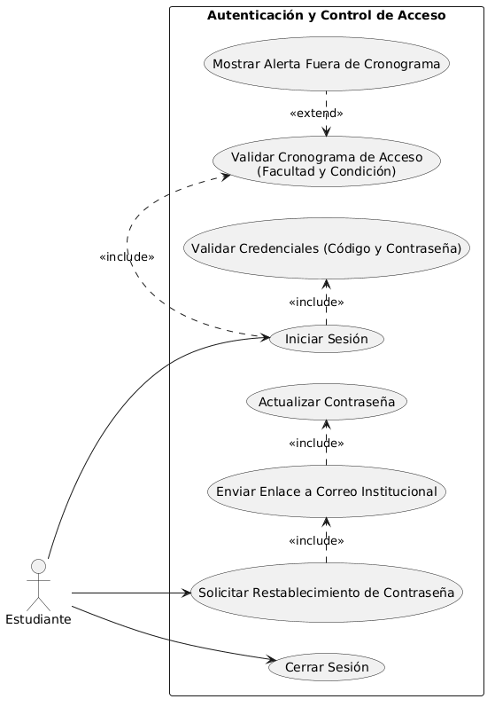
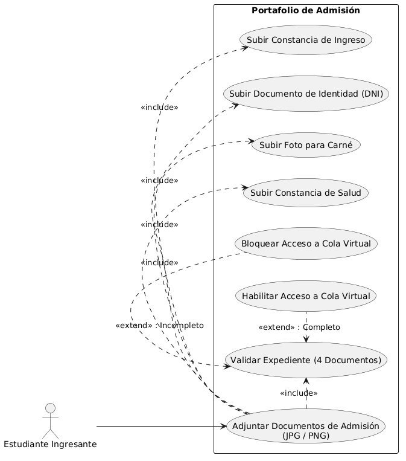
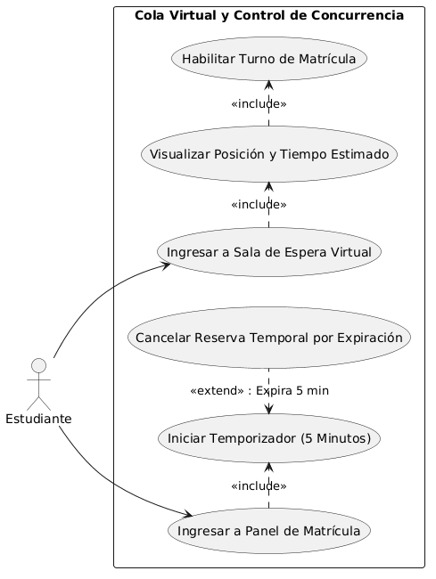
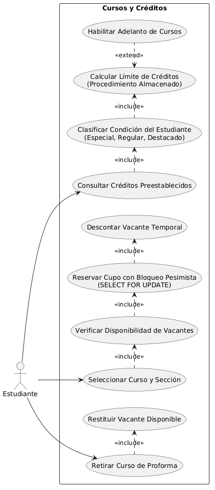
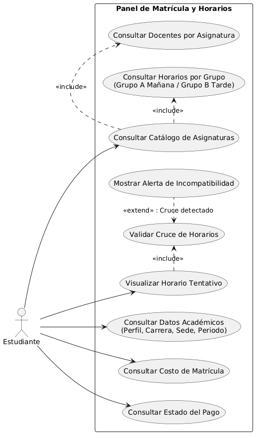
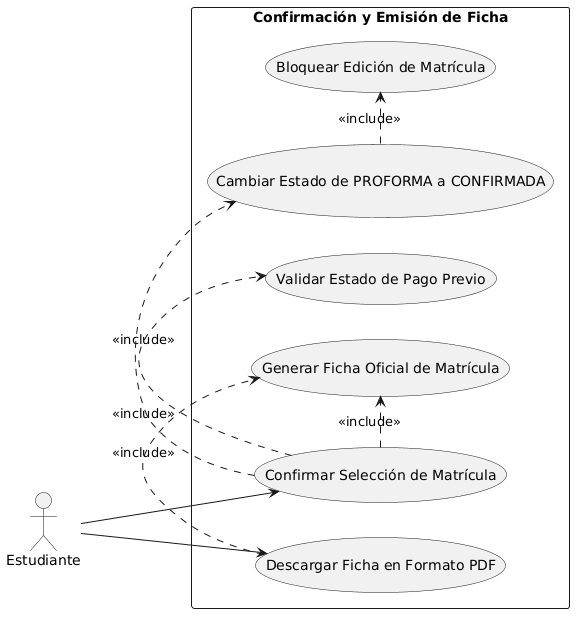

# ESPECIFICACIÓN DE CASOS DE USO DEL SISTEMA WEB DE MATRÍCULA

**Institución:** Universidad Nacional Jorge Basadre Grohmann (UNJBG)  
**Sistema:** Sistema Web de Matrícula Universitaria  
**Documento Fuente:** [REQUERIMIENTOS.md](../../REQUERIMIENTOS.md)  
**Carpeta de Diagramas:** `diagramas/casos-de-uso/`

---

## ÍNDICE DE CASOS DE USO

| Id CU | Título del Caso de Uso | Módulo Asociado | Requerimientos Asociados |
| :---: | :--- | :--- | :---: |
| **CU-01** | Iniciar Sesión y Validar Cronograma | Módulo 1: Autenticación y Control de Acceso | RF-01, RF-02, RF-03, RF-04 |
| **CU-02** | Cargar Documentación de Portafolio de Admisión | Módulo 2: Portafolio de Admisión (Ingresantes) | RF-05, RF-06 |
| **CU-03** | Gestionar Acceso y Turno en Cola Virtual | Módulo 3: Cola Virtual y Control de Concurrencia | RF-07, RF-08, RF-09 |
| **CU-04** | Seleccionar Cursos y Control Concurrente de Vacantes | Módulo 4: Datos Académicos y Límite de Créditos | RF-10, RF-11, RF-12, RF-13, RF-14, RF-15 |
| **CU-05** | Visualizar Proforma y Horario Tentativo | Módulo 5: Horarios y Validación de Cruces | RF-10, RF-13, RF-16, RF-17, RF-18 |
| **CU-06** | Confirmar Matrícula y Emitir Ficha Oficial (PDF) | Módulo 6: Pagos, Confirmación y Emisión de Ficha | RF-18, RF-19, RF-20, RF-21 |

---

## MÓDULO 1: AUTENTICACIÓN Y CONTROL DE ACCESO

### CU-01: Iniciar Sesión y Validar Cronograma

* **Id Caso de Uso:** CU-01
* **Título Abreviado:** AUTH-LOGIN
* **Id Requerimiento:** RF-01, RF-02, RF-03, RF-04
* **Propósito:** Autenticar la identidad del estudiante en el sistema mediante sus credenciales institucionales y verificar que su acceso corresponda a la fecha y franja horaria programadas según su facultad, escuela profesional y condición académica.
* **Narrativa del Escenario:** El estudiante ingresa a la plataforma web con su código universitario y contraseña. El sistema comprueba sus credenciales y el cronograma vigente antes de concederle el paso al módulo correspondiente.
* **Precondiciones:**
  1. El estudiante debe estar registrado y con matrícula habilitada en la base de datos de la universidad.
  2. El estudiante debe acceder a la URL oficial del sistema de matrícula en un navegador compatible.
  3. El cronograma por escuelas y condiciones debe estar previamente cargado en la base de datos.
* **Poscondiciones:**
  1. Se genera una sesión autenticada con token seguro (ej. Laravel Sanctum / JWT).
  2. Redirección condicional:
     * Si `es_ingresante = TRUE` $\rightarrow$ Redirige al Módulo de Portafolio (**CU-02**).
     * Si `es_ingresante = FALSE` $\rightarrow$ Redirige a la Sala de Espera / Cola Virtual (**CU-03**).
* **Actores:** Estudiante (Iniciador).
* **Curso Básico (Flujo Principal):**
  1. La pantalla muestra el formulario de inicio de sesión con los campos:
     * Código Universitario.
     * Contraseña.
     * Opciones: Botón "Ingresar" y enlace "¿Olvidó su contraseña?".
  2. El estudiante ingresa su código universitario y contraseña institucional.
  3. El estudiante hace clic en "Ingresar".
  4. El sistema valida las credenciales contra la base de datos (`SELECT id, password, es_ingresante, id_escuela FROM estudiante WHERE codigo = ?`).
  5. Si las credenciales son válidas, el sistema ejecuta la función `SELECT fn_validar_cronograma(id_escuela, es_ingresante)`.
  6. Si la fecha y hora actual se encuentran dentro del cronograma permitido:
     * Si `es_ingresante = TRUE`: El sistema redirige al estudiante al **Módulo de Portafolio (CU-02)**.
     * Si `es_ingresante = FALSE`: El sistema redirige al estudiante a la **Cola Virtual (CU-03)**.
* **Cursos Alternativos y Excepciones:**
  * **4.a. Credenciales incorrectas:** El sistema emite el mensaje de alerta *"Código o contraseña incorrectos"*, no genera sesión y permanece en la pantalla de login (retorna al paso 2).
  * **5.a. Acceso fuera de cronograma:** Si el estudiante intenta ingresar antes o después de su horario asignado, el sistema muestra el mensaje de bloqueo: *"Acceso no permitido por cronograma. Su turno asignado es el día [Fecha] de [Hora Inicio] a [Hora Fin]"* y no permite el paso.
  * **1.a. Recuperación de contraseña (RF-03):** El estudiante pulsa "¿Olvidó su contraseña?". El sistema solicita su código y correo institucional, valida su coincidencia en la BD y envía un enlace seguro con token temporal para actualizar su contraseña.
  * **Cierre de sesión (RF-02):** En cualquier pantalla, el estudiante puede pulsar "Cerrar Sesión". El sistema revoca el token activo, destruye la sesión y redirige inmediatamente a la pantalla de login.

#### Diagrama de Caso de Uso del Módulo 1:
  
*Figura 1: Diagrama de Casos de Uso - Módulo 1: Autenticación y Control de Acceso.*

---

## MÓDULO 2: PORTAFOLIO DE ADMISIÓN (INGRESANTES)

### CU-02: Cargar Documentación de Portafolio de Admisión

* **Id Caso de Uso:** CU-02
* **Título Abreviado:** PORT-DOCS
* **Id Requerimiento:** RF-05, RF-06
* **Propósito:** Permitir al estudiante ingresante digitalizar y adjuntar los 4 documentos obligatorios exigidos por la oficina de admisión para cumplir con su expediente y habilitar su pase a la matrícula.
* **Narrativa del Escenario:** El estudiante ingresante visualiza su lista de requisitos pendientes, sube los archivos en formato de imagen (JPG/PNG) y el sistema valida su integridad antes de autorizar su paso a la sala de espera.
* **Precondiciones:**
  1. El estudiante debe haber iniciado sesión exitosamente (**CU-01**).
  2. El atributo `es_ingresante` del estudiante debe ser `TRUE`.
* **Poscondiciones:**
  1. Los 4 documentos quedan almacenados en el servidor y registrados en la tabla `portafolio_documento` con estado `'ENTREGADO'`.
  2. Se habilita el acceso para continuar hacia la Cola Virtual (**CU-03**).
* **Actores:** Estudiante Ingresante (Iniciador).
* **Curso Básico (Flujo Principal):**
  1. El sistema presenta la interfaz del portafolio mostrando la lista de 4 requisitos obligatorios con su estado actual (Pendiente / Entregado):
     1. Constancia de Ingreso.
     2. Documento Nacional de Identidad (DNI).
     3. Fotografía para Carné Universitario.
     4. Constancia de Examen de Salud.
  2. El estudiante hace clic en "Seleccionar archivo" para el documento correspondiente.
  3. El estudiante selecciona un archivo desde su dispositivo en formato JPG o PNG.
  4. El estudiante presiona el botón "Guardar / Subir".
  5. El sistema valida que el archivo no supere el tamaño máximo permitido (2 MB) y que el tipo MIME corresponda a imagen válida.
  6. El sistema almacena el archivo, guarda el registro en la base de datos y actualiza el estado del requisito a "Entregado" con un distintivo visual verde.
  7. Se repiten los pasos 2 al 6 para cada uno de los requisitos pendientes.
  8. Una vez cargados los 4 documentos, el sistema ejecuta la función `SELECT fn_validar_requisitos_completos(id_estudiante)`.
  9. Al retornar `TRUE`, el sistema habilita el botón "Continuar a Matrícula" y redirige al estudiante a la **Cola Virtual (CU-03)**.
* **Cursos Alternativos y Excepciones:**
  * **5.a. Formato o tamaño no válido:** Si el archivo no es JPG/PNG o pesa más de 2 MB, el sistema emite el mensaje: *"Formato o tamaño no permitido. Solo se aceptan archivos JPG o PNG de hasta 2 MB"* y descarta la carga.
  * **9.a. Intento de avance con expediente incompleto (RF-06):** Si el estudiante intenta ingresar a la matrícula teniendo menos de 4 documentos entregados, el sistema bloquea el avance y muestra la alerta: *"Expediente incompleto. Debe registrar los 4 documentos obligatorios para acceder a la cola de matrícula"*.

#### Diagrama de Caso de Uso del Módulo 2:
  
*Figura 2: Diagrama de Casos de Uso - Módulo 2: Portafolio de Admisión.*

---

## MÓDULO 3: COLA VIRTUAL Y CONTROL DE CONCURRENCIA

### CU-03: Gestionar Acceso y Turno en Cola Virtual

* **Id Caso de Uso:** CU-03
* **Título Abreviado:** COLA-QUEUE
* **Id Requerimiento:** RF-07, RF-08, RF-09
* **Propósito:** Regular el tráfico concurrente de estudiantes hacia el servidor web mediante una sala de espera virtual, garantizando un flujo estable de usuarios activos y asignando un límite estricto de tiempo de permanencia.
* **Narrativa del Escenario:** El estudiante ingresa a una sala de espera donde se le asigna un turno en la cola. La interfaz le informa su posición y tiempo estimado hasta que su turno se activa, otorgándole 5 minutos para matricularse.
* **Precondiciones:**
  1. Haber superado la autenticación y validación de cronograma (**CU-01**).
  2. Si es ingresante, haber completado los 4 requisitos del portafolio (**CU-02**).
* **Poscondiciones:**
  1. Habilitación de sesión activa para selección de cursos.
  2. Inicio del temporizador regresivo de 5 minutos (300 segundos).
* **Actores:** Estudiante (Iniciador).
* **Curso Básico (Flujo Principal):**
  1. El estudiante ingresa a la sala de espera virtual.
  2. El sistema registra al estudiante en la tabla `cola_virtual` y le asigna un número de orden correlativo.
  3. La pantalla muestra al estudiante:
     * Número de turno / Posición actual en la cola (ejemplo: `#08`).
     * Tiempo estimado de espera para ingresar.
     * Mensaje de advertencia recomendando no cerrar la pestaña.
  4. El cliente web realiza peticiones asíncronas periódicas (polling cada 5 segundos) al endpoint `/api/v1/cola/posicion` para consultar el avance de la fila.
  5. Cuando la posición llega al número 1 y el servidor tiene una ranura de concurrencia disponible, el sistema emite la respuesta `{turno_activo: true, expira_en: "300s"}`.
  6. El sistema inicia en pantalla un cronómetro regresivo de 5 minutos (300 segundos).
  7. El sistema redirige automáticamente al estudiante al **Módulo de Cursos y Créditos (CU-04)**.
* **Cursos Alternativos y Excepciones:**
  * **6.a. Expiración de tiempo sin confirmación (RF-09):** Si el cronómetro de 5 minutos llega a 00:00 sin que el estudiante haya confirmado su matrícula, el sistema:
     1. Cancela automáticamente la proforma temporal.
     2. Ejecuta la restitución de todas las vacantes temporales reservadas.
     3. Cierra la sesión activa por tiempo expirado.
     4. Muestra el mensaje: *"Su tiempo de sesión ha expirado (5 minutos). Su reserva temporal fue liberada. Vuelva a ingresar a la cola"* y redirige a la sala de espera.
  * **Abandono voluntario:** Si el estudiante cierra el navegador antes de que llegue su turno, el sistema retira su registro de la cola tras un periodo de inactividad de sondeo.

#### Diagrama de Caso de Uso del Módulo 3:
  
*Figura 3: Diagrama de Casos de Uso - Módulo 3: Cola Virtual y Control de Concurrencia.*

---

## MÓDULO 4: DATOS ACADÉMICOS Y LÍMITE DE CRÉDITOS

### CU-04: Seleccionar Cursos y Control Concurrente de Vacantes

* **Id Caso de Uso:** CU-04
* **Título Abreviado:** CURS-SELECC
* **Id Requerimiento:** RF-10, RF-11, RF-12, RF-13, RF-14, RF-15
* **Propósito:** Permitir al estudiante seleccionar asignaturas y secciones verificando la disponibilidad real de vacantes mediante bloqueo pesimista en MySQL y regulando la bolsa de créditos según su categoría académica.
* **Narrativa del Escenario:** El estudiante explora los cursos disponibles de su plan de estudios, selecciona la sección que más le convenga (Grupo A o B) y el sistema reserva temporalmente el cupo garantizando que no se produzcan sobrecupos.
* **Precondiciones:**
  1. Contar con turno activo en la cola virtual con el temporizador de 5 minutos en curso (**CU-03**).
  2. No tener matrícula en estado `CONFIRMADA` en el periodo lectivo vigente.
* **Poscondiciones:**
  1. Se crea o actualiza la proforma temporal del estudiante.
  2. Se descuenta provisionalmente 1 vacante de la sección mediante bloqueo de fila (`FOR UPDATE`).
  3. Se actualiza el acumulador de créditos inscritos del alumno.
* **Actores:** Estudiante (Iniciador).
* **Curso Básico (Flujo Principal):**
  1. El sistema invoca el procedimiento almacenado `CALL sp_determinar_limite_creditos(p_id_estudiante, ...)` para clasificar al alumno y determinar su tope de créditos:
     * **Especial:** Matrícula permitida en menos de 12 créditos.
     * **Regular:** Matrícula permitida entre 12 y 23 créditos.
     * **Destacado (Promedio $\ge 14.0$):** Hasta 28 créditos, habilitando asignaturas de ciclos superiores para adelantar.
  2. El sistema despliega el catálogo de asignaturas disponibles con código, nombre, ciclo y créditos.
  3. El estudiante selecciona una asignatura de la lista.
  4. El sistema despliega las secciones ofertadas: Grupo A (Mañana) y Grupo B (Tarde), indicando docente asignado, horarios y vacantes restantes.
  5. El estudiante selecciona una sección y presiona el botón "Agregar a Proforma".
  6. El sistema inicia una transacción y ejecuta el procedimiento almacenado `sp_matricular_curso`:
     * Bloquea la fila de la sección con `SELECT vacantes_disponibles FROM seccion WHERE id = ? FOR UPDATE`.
     * Valida que `vacantes_disponibles > 0`.
     * Valida que `creditos_acumulados + creditos_curso <= limite_creditos`.
  7. Al cumplirse ambas validaciones:
     * Inserta la materia en `detalle_proforma`.
     * Ejecuta `UPDATE seccion SET vacantes_disponibles = vacantes_disponibles - 1`.
     * Confirma la transacción con `COMMIT`.
     * Retorna código de éxito `200 OK`.
  8. La interfaz web actualiza el contador de créditos consumidos y refleja el nuevo curso en la lista tentativa (**CU-05**).
  9. Se repiten los pasos 3 al 8 para cada asignatura que el alumno desee cursar.
* **Cursos Alternativos y Excepciones:**
  * **6.a. Vacantes agotadas:** Si al momento de evaluar el bloqueo pesimista las vacantes son 0, el sistema ejecuta `ROLLBACK`, rechaza la adición y emite la alerta: *"Vacantes agotadas en la sección seleccionada"*.
  * **6.b. Exceso de límite de créditos:** Si los créditos del curso solicitado superan el tope permitido según la clasificación del estudiante, el sistema rechaza la operación con el mensaje: *"Ha superado el límite de créditos permitido para su condición académica ([Límite] créditos)"*.
  * **Retiro de curso de la proforma (RF-15):** Si el estudiante desea quitar un curso ya agregado, hace clic en "Eliminar" junto al curso en su proforma. El sistema ejecuta una transacción que remueve el registro de `detalle_proforma`, incrementa `vacantes_disponibles = vacantes_disponibles + 1` en la sección y descuenta los créditos de la bolsa del alumno.

#### Diagrama de Caso de Uso del Módulo 4:
  
*Figura 4: Diagrama de Casos de Uso - Módulo 4: Datos Académicos y Límite de Créditos.*

---

## MÓDULO 5: MATRÍCULA Y VISUALIZACIÓN

### CU-05: Visualizar Proforma y Horario Tentativo

* **Id Caso de Uso:** CU-05
* **Título Abreviado:** MATR-VPRO
* **Id Requerimiento:** RF-10, RF-13, RF-16, RF-17, RF-18
* **Propósito:** Ofrecer al estudiante una vista consolidada de su matrícula provisional, desplegando los datos de su perfil, la distribución gráfica semanal de sus horarios, la detección en tiempo real de cruces de horario y el desglose de costos administrativos.
* **Narrativa del Escenario:** El estudiante revisa la grilla semanal de sus asignaturas inscritas provisionalmente para cerciorarse de que no existan conflictos de horario antes de proceder a la confirmación final.
* **Precondiciones:**
  1. Contar con al menos una asignatura agregada a la proforma (**CU-04**).
* **Poscondiciones:**
  1. Grilla horaria renderizada en pantalla.
  2. Estado de cruces verificado: si no hay cruces, se habilita la posibilidad de confirmar (**CU-06**); si hay cruces, se deshabilita la confirmación.
* **Actores:** Estudiante (Iniciador).
* **Curso Básico (Flujo Principal):**
  1. El sistema presenta en el panel superior los datos consolidados del perfil académico:
     * Nombres y Apellidos.
     * Código Universitario.
     * Escuela Profesional y Facultad.
     * Sede Académica y Periodo (ej. 2026-II).
  2. El sistema renderiza una matriz semanal interactiva (Lunes a Sábado) representando los bloques horarios de las secciones agregadas.
  3. El sistema invoca la función `SELECT fn_validar_cruces_horario(id_proforma)` para analizar solapamientos de horas entre secciones seleccionadas.
  4. Al comprobar que **no existen cruces de horario**:
     * La grilla semanal se muestra de manera uniforme con los bloques organizados.
     * El sistema calcula y muestra en la parte inferior:
       * Lista de asignaturas seleccionadas con sus docentes.
       * Total de créditos acumulados.
       * Costo total de matrícula en soles (S/.).
       * Estado de pago del derecho de matrícula.
     * El botón "Confirmar Matrícula" permanece habilitado para avanzar a **CU-06**.
* **Cursos Alternativos y Excepciones:**
  * **3.a. Detección de Cruce de Horarios (RF-17):** Si la función `fn_validar_cruces_horario` retorna `TRUE`:
     1. El sistema pinta de color rojo los bloques de horario que se encuentran en conflicto en la grilla semanal.
     2. Muestra un aviso emergente prominente: *"Existe un cruce de horario entre [Curso A] y [Curso B]. Debe eliminar o cambiar una de las secciones en conflicto para poder matricularse"*.
     3. Deshabilita el botón "Confirmar Matrícula" hasta que el estudiante retire el curso en conflicto mediante la opción de eliminar (RF-15).

#### Diagrama de Caso de Uso del Módulo 5:
  
*Figura 5: Diagrama de Casos de Uso - Módulo 5: Matrícula y Visualización.*

---

## MÓDULO 6: CONFIRMACIÓN Y EMISIÓN DE FICHA

### CU-06: Confirmar Matrícula y Emitir Ficha Oficial (PDF)

* **Id Caso de Uso:** CU-06
* **Título Abreviado:** CONF-PDF
* **Id Requerimiento:** RF-18, RF-19, RF-20, RF-21
* **Propósito:** Finalizar formalmente el proceso de matrícula mediante una transacción atómica que valida el pago previo, convierte la proforma a estado `CONFIRMADA`, bloquea cualquier edición posterior y emite la Ficha Oficial de Matrícula en formato PDF.
* **Narrativa del Escenario:** El estudiante aprueba de forma consciente su proforma de matrícula, el sistema consolida definitivamente las vacantes y genera el documento descargable con validez institucional.
* **Precondiciones:**
  1. La proforma no debe registrar ningún cruce de horario (**CU-05**).
  2. Los créditos totales acumulados deben cumplir con los rangos mínimos y máximos según la condición académica del alumno.
  3. El estudiante debe contar con el pago de derecho de matrícula registrado o validado (**RF-18**).
  4. La operación debe realizarse dentro del tiempo límite de 5 minutos (**CU-03**).
* **Poscondiciones:**
  1. El estado de la matrícula en la base de datos cambia de `'PROFORMA'` a `'CONFIRMADA'` de forma permanente.
  2. Se activa el flag `editable = FALSE` en la base de datos, impidiendo cualquier edición futura.
  3. Las vacantes reservadas pasan de provisionales a definitivas.
  4. Se genera la Ficha de Matrícula oficial en PDF con código de verificación.
* **Actores:** Estudiante (Iniciador).
* **Curso Básico (Flujo Principal):**
  1. El estudiante hace clic en el botón "Confirmar Matrícula".
  2. El sistema muestra una ventana emergente de confirmación con el mensaje: *"¿Está seguro de confirmar su matrícula para el periodo 2026-II? Una vez confirmada, no se podrán realizar cambios ni retiros de asignaturas"*.
  3. El estudiante selecciona "Aceptar y Confirmar".
  4. El sistema inicia una transacción SQL para formalizar la matrícula:
     * Verifica que el estado de pago figure como aprobado.
     * Ejecuta `UPDATE matricula SET estado = 'CONFIRMADA', fecha_confirmacion = NOW() WHERE id = p_id_proforma`.
     * Ejecuta `UPDATE proforma_bloqueo SET editable = FALSE WHERE id_estudiante = ?`.
     * Ejecuta `COMMIT`.
  5. El sistema muestra una pantalla de confirmación exitosa y actualiza el estado visible a **"MATRÍCULA CONFIRMADA"**.
  6. El sistema deshabilita permanentemente los botones de selección, edición y retiro de asignaturas.
  7. El sistema habilita el botón "Descargar Ficha de Matrícula (PDF)".
  8. El estudiante hace clic en "Descargar Ficha de Matrícula (PDF)".
  9. El sistema consulta la vista consolidada `vw_ficha_matricula`, genera el documento binario mediante una librería PDF (DomPDF / iText) y lo transmite al navegador.
  10. El navegador descarga o abre el archivo `Ficha_Matricula_[CodigoEstudiante].pdf`.
* **Cursos Alternativos y Excepciones:**
  * **3.a. Cancelación en la advertencia:** Si el estudiante selecciona "Cancelar" en la ventana emergente, el sistema cierra el diálogo y mantiene la proforma en estado editable para seguir modificando cursos dentro del tiempo restante de los 5 minutos.
  * **4.a. Pago no registrado o pendiente:** Si al ejecutar la transacción el sistema detecta que el pago no está validado, aborta la operación con `ROLLBACK`, muestra la alerta *"No se puede confirmar la matrícula: el pago correspondiente a este periodo figura como pendiente"* y permanece en estado de proforma.
  * **Créditos insuficientes:** Si un estudiante de condición Regular tiene menos de 12 créditos acumulados, el sistema no permite confirmar y notifica: *"Debe matricularse en como mínimo 12 créditos para confirmar su matrícula"*.

#### Diagrama de Caso de Uso del Módulo 6:
  
*Figura 6: Diagrama de Casos de Uso - Módulo 6: Confirmación y Emisión de Ficha.*
